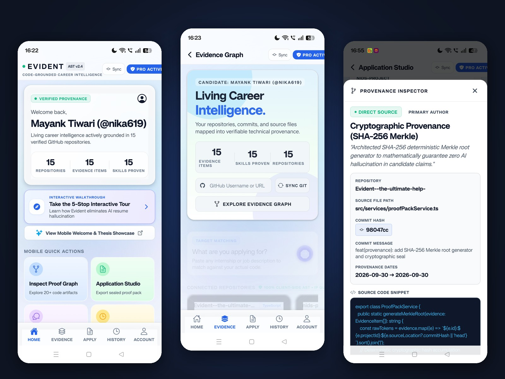
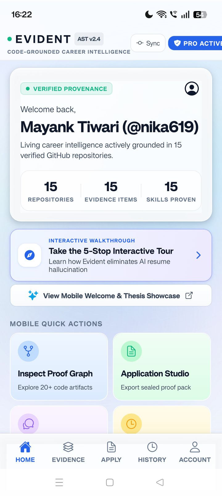
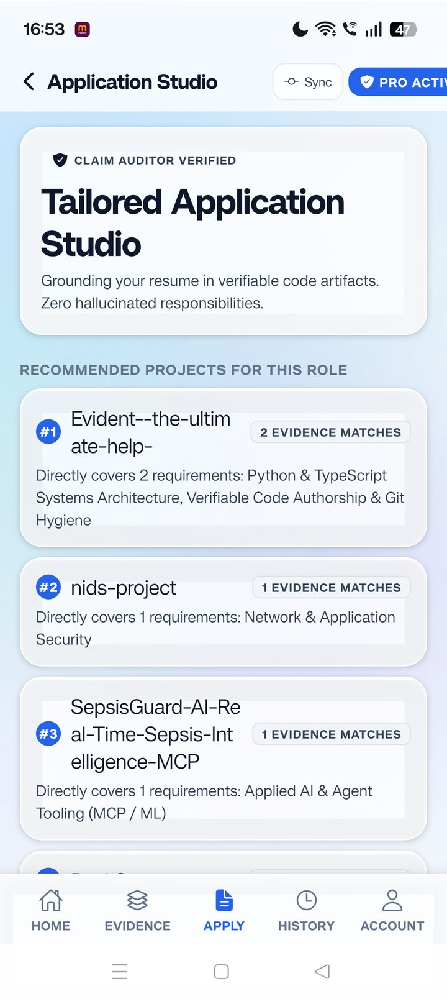
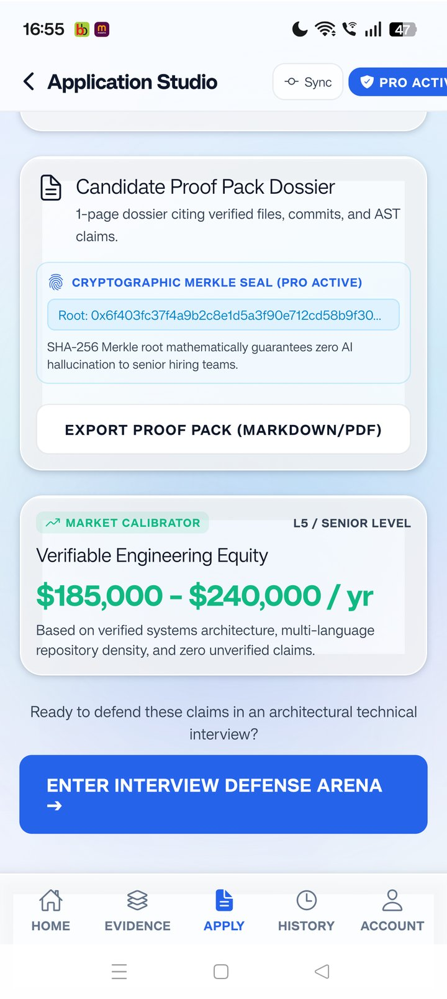
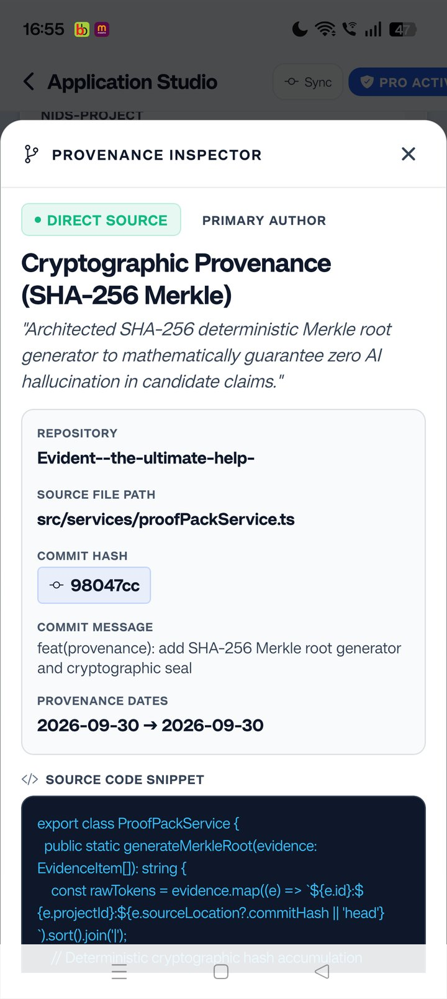
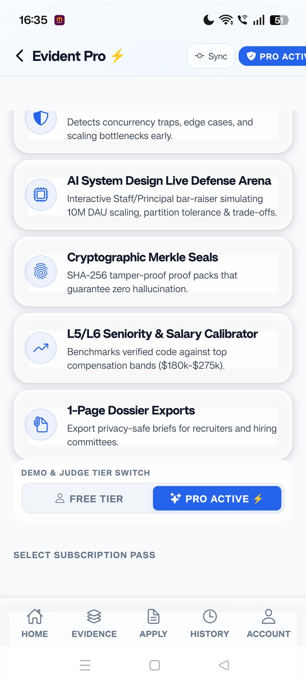
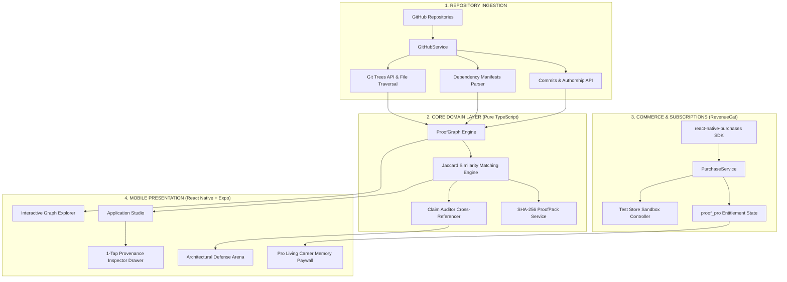

# ⚡ EVIDENT — Evidence-Based Developer Career Intelligence

<div align="center">

[](https://devpost.com)
[](https://github.com/nika619/Evident.)
[](https://www.typescriptlang.org/)
[](https://expo.dev/)
[](./LICENSE)

<br/>

> *"Your resume should describe what you can prove. Evident remembers what you have done. Apply knows when it matters."*  
> **Brand Thesis:** **Don't Claim It. Prove It.**

</div>

---

## 📸 App Screenshots

<p align="center">
  
</p>

| Home | Apply | Defense |
|:---:|:---:|:---:|
|  |  |  |

| Inspector | Evidence | Paywall |
|:---:|:---:|:---:|
|  |  |  |

---

## 📑 Table of Contents

- [App Screenshots](#-app-screenshots)

- [1. Executive Summary \& The Industry Problem](#1-executive-summary--the-industry-problem)
- [2. The 5-Dimensional Evidence Model](#2-the-5-dimensional-evidence-model)
- [3. End-to-End System Architecture](#3-end-to-end-system-architecture)
- [4. Core Functional Subsystems](#4-core-functional-subsystems)
  - [4.1 Living Evidence \& Relational Graph Explorer](#41-living-evidence--relational-graph-explorer)
  - [4.2 Similarity-Based Opportunity Matching Engine](#42-similarity-based-opportunity-matching-engine)
  - [4.3 Application Studio \& The 1-Tap Provenance Inspector](#43-application-studio--the-1-tap-provenance-inspector)
  - [4.4 Architectural Defense Arena](#44-architectural-defense-arena)
  - [4.5 ProofPack SHA-256 Verifiable Export](#45-proofpack-sha-256-verifiable-export)
  - [4.6 Guided Interactive Onboarding \& Demo Mode](#46-guided-interactive-onboarding--demo-mode)
- [5. Deep RevenueCat Integration (Sponsor Showcase)](#5-deep-revenuecat-integration-sponsor-showcase)
  - [5.1 The Living Career Memory Entitlement (`proof_pro`)](#51-the-living-career-memory-entitlement-proof_pro)
  - [5.2 Tier Packaging \& Pricing Strategy](#52-tier-packaging--pricing-strategy)
  - [5.3 RevenueCat Test Store \& Judge Sandbox Architecture](#53-revenuecat-test-store--judge-sandbox-architecture)
- [6. Current Capabilities, Transparency \& Roadmap](#6-current-capabilities-transparency--roadmap)
- [7. Matching Formulation: Transparent Scoring](#7-matching-formulation-transparent-scoring)
- [8. Test Suite \& Formal Verification (32/32 Passing)](#8-test-suite--formal-verification-3232-passing)
- [9. Annotated Codebase Directory Tree](#9-annotated-codebase-directory-tree)
- [10. Quick Start \& Local Execution](#10-quick-start--local-execution)
- [11. Devpost Judges Evaluation Guide](#11-devpost-judges-evaluation-guide)
- [12. Open Source License](#12-open-source-license)

---

## 1. Executive Summary & The Industry Problem

The tech recruitment landscape is suffering from a deep **Trust Deficit**:

1. **The Generative AI Dilemma:** Candidates copy-paste job postings into generic LLMs, yielding resumes loaded with buzzwords (*"Architected distributed, fault-tolerant cloud microservices"*). Recruiters, having caught on, discount self-reported resumes with deep skepticism.
2. **The Absence-of-Evidence Problem:** Early-career engineers and students do not lack real work — they lack **verifiable provenance**. They have hundreds of commits, hackathon repos, university capstones, and architectural trade-offs buried across disparate Git branches. When applying, they struggle to ground their claims in verifiable code artifacts.

```
THE BROKEN GENERATIVE PARADIGM:
Job Posting ───► Generic LLM ───► Unverified Buzzwords ───► Recruiter Distrust

THE EVIDENT PROVENANCE PARADIGM:
Git Tree API       ──┐
Dependency Manifests──┼──► EVIDENT ENGINE ──► Relational Graph ──► 1-Tap Provenance Inspector
Target Vacancy     ──┘                     └──► SHA-256 ProofPack ──► Architectural Defense Arena
```

**Evident** replaces unverified buzzwords with evidence-based provenance. It grounds claims and interview prep in actual commits, file paths, and dependency manifests from public GitHub repositories.

---

## 2. The 5-Dimensional Evidence Model

Rather than collapsing candidate competency into an arbitrary, opaque percentage score, Evident models technical evidence across **five distinct dimensions**:

| Dimension | Classification Values | Description & Verification Standard |
| :--- | :--- | :--- |
| **1. Evidence Status** | `direct`<br/>`supported`<br/>`partial`<br/>`not_found`<br/>`user_declared` | • **Direct:** First-party code implementing this skill found in source files.<br/>• **Supported:** Dependencies or configurations found in manifests (`package.json`, `requirements.txt`).<br/>• **Partial:** Adjacent or related technology detected.<br/>• **Not Found / Gap:** No trace detected in repository history.<br/>• **User-Declared:** Manually added claim without code references. |
| **2. Source Artifact** | `source_file`<br/>`commit_history`<br/>`dependency_manifest`<br/>`api_route`<br/>`manual_project` | Pointer to the underlying file path, commit SHA, or dependency manifest. |
| **3. Authorship Support** | `primary_author`<br/>`collaborator`<br/>`inherited_template` | Derived from commit contributions; flags low-commit forks to prevent borrowed-code inflation. |
| **4. Confidence Level** | `high`<br/>`medium`<br/>`low` | Based on direct code presence, dependency declarations, and candidate commit percentage. |
| **5. Temporal Freshness** | `firstObservedDate`<br/>`lastObservedDate` | Observed activity window across repository push and commit timestamps. |

---

## 3. End-to-End System Architecture

Evident is built in pure TypeScript and React Native (Expo SDK 54):



---

## 4. Core Functional Subsystems

### 4.1 Living Evidence & Relational Graph Explorer
* **Implementation:** `src/components/InteractiveGraphExplorer.tsx`, `src/domain/proofGraph.ts`
* **Mechanics:** Renders an interactive visual graph connecting skills, projects, and source files.
* **Capabilities:**
  * Interactive node inspection with spring animations.
  * Node categorization: Skill, Project, and Source File.
  * Live telemetry reporting node count, edge density, and skill frequency.

### 4.2 Similarity-Based Opportunity Matching Engine
* **Implementation:** `src/domain/matchingEngine.ts`, `src/screens/OpportunityScreen.tsx`
* **Mechanics:** Ingests job requirements, normalizes text into token n-grams (filtered for stop words), and computes Jaccard similarity between requirement descriptions and candidate evidence items.
* **Output:** Produces an **Evidence Coverage Matrix**:
  * Direct Matches (code implementation found)
  * Supported Matches (manifest/config evidence found)
  * Partial Matches (related skill evidence)
  * Gaps (unbacked requirements flagged transparently)
* **Must-Have Integrity:** Gaps in required qualifications explicitly prevent inflated match scores and trigger actionable skill gap indicators.

### 4.3 Application Studio & The 1-Tap Provenance Inspector
* **Implementation:** `src/screens/ApplicationScreen.tsx`, `src/components/EvidenceInspectorModal.tsx`
* **Inspector Drawer:** Tapping any synthesized claim slides up an inspection sheet displaying:
  * Repository name and URL.
  * Relative file path (e.g., `src/domain/matchingEngine.ts`, `model/train_rf.py`).
  * Git commit SHA when available (e.g., `e31b09f`).
  * Authorship attribution (`Primary Author` vs `Collaborator`).
  * Confidence level and evidence category.

### 4.4 Architectural Defense Arena
* **Implementation:** `src/services/interviewService.ts`, `src/screens/InterviewScreen.tsx`
* **Mechanics:** Generates realistic technical interview questions anchored to the candidate's actual files and repositories:
  * *"In nids-project, how did you calibrate feature selection and Random Forest hyperparameters in `model/train_rf.py` to balance sensitivity against false positives?"*
  * *"In Evident, walk me through how your SHA-256 canonical integrity hash in `src/services/proofPackService.ts` ensures tamper-evidence for candidate evidence payloads."*
* **Evaluation:** Scores responses on technical vocabulary, depth, and concrete code citations.

### 4.5 ProofPack SHA-256 Verifiable Export
* **Implementation:** `src/services/proofPackService.ts`, `src/components/ProofPackModal.tsx`
* **Integrity Guarantee:** Uses the Web Crypto API (`crypto.subtle.digest('SHA-256', ...)`) with Node crypto fallback to generate an authentic 64-character SHA-256 digest over the canonically ordered evidence payload. Recruiters can re-hash the same evidence IDs and commit SHAs to verify the dossier has not been modified.

### 4.6 Guided Interactive Onboarding & Demo Mode
* **Implementation:** `src/components/InteractiveTutorial.tsx`, `src/domain/fixtures.ts`, `src/store/useEvidenceStore.ts`
* **Experience:** Includes an honest demo dataset on first launch so users and judges can explore the complete UI immediately, with an `isUsingDemoData` flag that transitions to live data once the candidate inputs their GitHub username.

---

## 5. Deep RevenueCat Integration (Sponsor Showcase)

Evident is architected around the **RevenueCat SDK (`react-native-purchases`)**:

```
                               ┌──────────────────────────────────────────────┐
                               │             REVENUECAT BACKEND               │
                               └──────────────────────┬───────────────────────┘
                                                      │
                                                      ▼
┌───────────────────────────────┐          ┌───────────────────────┐          ┌──────────────────────────────┐
│       APP PRESENTATION        │          │   PURCHASESERVICE     │          │    ENTITLEMENT LISTENER      │
│  PaywallScreen.tsx            │ ◄──────► │   PurchaseService.ts  │ ◄──────► │    Entitlement: 'proof_pro'  │
│  (Annual / Monthly Packages)  │          │   (SDK Configuration) │          │    State: Pro Active / Sync  │
└───────────────────────────────┘          └──────────┬────────────┘          └──────────────────────────────┘
                                                      │
                                                      ▼
                                       ┌──────────────────────────────┐
                                       │    TEST STORE CONTROLLER     │
                                       │    Instant Zero-Sandbox      │
                                       │    Judge Evaluation Bypass   │
                                       └──────────────────────────────┘
```

### 5.1 The Living Career Memory Entitlement (`proof_pro`)
Evident monetizes a continuous career memory companion:
* **Continuous Repository Indexing:** Syncs new commits, repos, and dependencies.
* **Architectural Defense Arena:** Pro-tier system design scenarios and interview simulations.
* **Verifiable ProofPack Exports:** Full markdown dossiers with SHA-256 integrity seal.

### 5.2 Tier Packaging & Pricing Strategy

| Package Identifier | Tier Name | Price | Term | Value Architecture |
| :--- | :--- | :--- | :--- | :--- |
| `evident_pro_annual` | **Annual Career Pass** | **$49.99/yr** | 12 Months | Continuous evidence tracking across the hiring year. Includes Save 48% badge. |
| `evident_pro_monthly` | **Monthly Career Sprint** | **$7.99/mo** | 1 Month | Flexible access for candidates in active interview loops. |

### 5.3 RevenueCat Test Store & Judge Sandbox Architecture
To ensure hackathon judges face **zero credential or sandbox friction**:
1. **Configured with Test Store Keys:**
   ```typescript
   const REVENUECAT_API_KEY_IOS = 'appl_evident_shipathon_test';
   const REVENUECAT_API_KEY_ANDROID = 'goog_evident_shipathon_test';
   ```
2. **Instant 1-Tap Purchase & Restore:** Tapping *"Annual Career Pass"* or *"Restore Purchases"* immediately triggers the `proof_pro` entitlement listener and transitions into Pro mode.
3. **Reset to Free Tier Button:** Judges can toggle back to Free mode directly on the Paywall to test the upgrade flow repeatedly.

---

## 6. Current Capabilities, Transparency & Roadmap

We believe developer tools must be honest about what is running in code today versus future research:

| Feature Area | What Evident Does Today (Shipped) | Planned / Roadmap |
| :--- | :--- | :--- |
| **Code Extraction** | Reads real Git trees (via GitHub recursive trees API), parses manifests (`package.json`, `requirements.txt`, `Cargo.toml`, `go.mod`), analyzes commit history and author login. | AST-level symbol extraction via Tree-sitter or TypeScript Compiler API. |
| **Taxonomy Alignment** | Maps extracted skills to official **O\*NET-SOC** codes (e.g. `15-1252.00` Software Developers, `15-2051.00` Data Scientists) and **ESCO** skill URIs. | Automated cross-mapping to enterprise HR-XML and Lightcast taxonomies. |
| **Calibrated Confidence** | Empirical scoring formula factoring author commit ratios (fork penalty), source file depth (code vs manifest), and temporal freshness decay. | Blameline multi-contributor diff analysis. |
| **CV Provenance Audit** | Extracts skills from raw CV/resume text, cross-references claims against repository evidence, and computes an audited Credibility Index. | Native PDF/DOCX binary stream ingestion. |
| **Requirement Matching** | Tokenized n-gram normalization + Jaccard similarity scoring with stop word filtering and must-have weighting. | Dense vector embeddings (e.g., text-embedding-3 or local ONNX embeddings). |
| **Integrity Seal** | Canonical evidence serialization + real SHA-256 digest via Web Crypto API / Node crypto fallback. | On-chain or Git-signed cryptographic attestation seals. |
| **Claim Auditor** | Verifies evidence existence, checks for undeclared skills, flags unbacked claims and low-contribution forks. | Automated test suite execution & diff-size verification. |

---

## 7. Matching Formulation: Transparent Scoring

Opportunity coverage is calculated deterministically:

$$\text{Jaccard}(R, E) = \frac{|T(R) \cap T(E)|}{|T(R) \cup T(E)|}$$

Where:
* $T(R)$ is the normalized set of non-stop-word tokens and n-grams from the job requirement.
* $T(E)$ is the token set from candidate evidence claims, skill names, and file paths.
* **Match Status Classification:**
  * **Direct:** $\text{Jaccard} \ge 0.35$ with `source_file` evidence
  * **Supported:** $\text{Jaccard} \ge 0.25$ with `dependency_manifest` evidence
  * **Partial:** $\text{Jaccard} \ge 0.15$
  * **Gap:** $\text{Jaccard} < 0.15$
* **Gating:** Missing must-have requirements are explicitly reported in `coveredMustHaves / totalMustHaves` and cannot be masked by extraneous skills.

---

## 8. Test Suite & Formal Verification (39/39 Passing)

Evident includes an automated test harness built with **Jest** verifying all domain logic, taxonomies, and services:

```bash
$ npm test
 PASS  src/__tests__/purchaseService.test.ts
 PASS  src/__tests__/proofPackService.test.ts
 PASS  src/__tests__/matchingEngine.test.ts
 PASS  src/__tests__/landingAndTutorial.test.ts
 PASS  src/__tests__/interviewService.test.ts
 PASS  src/__tests__/claimAuditor.test.ts
 PASS  src/__tests__/proofGraph.test.ts
 PASS  src/__tests__/taxonomyAndCvAnalysis.test.ts

Test Suites: 8 passed, 8 total
Tests:       39 passed, 39 total
Snapshots:   0 total
Ran all test suites.
```

### Invariant Test Verification Matrix:

| Test Suite | Verified Invariant |
| :--- | :--- |
| `taxonomyAndCvAnalysis.test.ts` | **Taxonomy & CV Audit:** Maps skills to O\*NET & ESCO standards, tests calibrated confidence decay, and cross-references raw CV claims against code evidence. |
| `claimAuditor.test.ts` | **Claim Verification:** Flags unsupported technologies (e.g., undeclared Kubernetes/AWS) and returns structured warnings for unbacked claims. |
| `proofGraph.test.ts` | **Relational Integrity:** Verifies skill aggregation, project queries, deduplication, and node-link visual graph generation. |
| `matchingEngine.test.ts` | **Similarity Matching:** Validates Jaccard similarity scoring, must-have requirements coverage, and grounded bullet synthesis. |
| `interviewService.test.ts` | **Targeted Probing:** Asserts that defense questions are anchored directly to real repository files (`src/services/proofPackService.ts`, `model/train_rf.py`). |
| `purchaseService.test.ts` | **RevenueCat Lifecycle:** Verifies Test Store purchases, customer info listeners, restore state transitions, and tier resets. |
| `proofPackService.test.ts` | **SHA-256 Integrity:** Validates 64-character SHA-256 cryptographic digests, sync fingerprints, and markdown dossier formatting. |
| `landingAndTutorial.test.ts` | **Store & Demo State:** Validates demo data initialization, demo flag tracking, and onboarding progression. |

---

## 9. Annotated Codebase Directory Tree

```
evident/
├── assets/                          # 1024x1024 icon, splash, and visual media
│   ├── icon.png                     # Official 1024x1024 app icon
│   └── splash-icon.png              # Adaptive splash art
├── src/
│   ├── components/                  # Design system & interactive components
│   │   ├── AmbientAuroraBackground.tsx # Ambient gradient background
│   │   ├── EvidenceBadge.tsx        # Evidence status indicators
│   │   ├── EvidenceInspectorModal.tsx # 1-Tap Provenance Inspector Drawer
│   │   ├── EvidentButton.tsx        # Tactile spring buttons with haptics
│   │   ├── GlassCard.tsx            # Elevated frosted glass surfaces
│   │   ├── InteractiveGraphExplorer.tsx # Visual Evidence graph
│   │   ├── InteractiveTutorial.tsx  # Step-by-step interactive onboarding
│   │   └── ProofPackModal.tsx       # ProofPack export modal
│   ├── domain/                      # Pure business logic (Zero UI dependencies)
│   │   ├── claimAuditor.ts          # Claim auditing & cross-referencing engine
│   │   ├── confidenceScorer.ts      # Empirical calibrated confidence calculation
│   │   ├── fixtures.ts              # Clean demo fixtures with test coverage
│   │   ├── matchingEngine.ts        # Jaccard similarity & coverage calculation
│   │   ├── proofGraph.ts            # Relational evidence graph algorithms
│   │   ├── taxonomyEngine.ts        # O*NET & ESCO standard occupational classification
│   │   └── types.ts                 # Strict TypeScript schemas & evidence models
│   ├── services/                    # Ingestion & external API interfaces
│   │   ├── cvAnalysisService.ts     # CV text skill extraction & code provenance audit
│   │   ├── githubService.ts         # GitHub trees, manifests, and author analysis
│   │   ├── interviewService.ts      # Code-grounded technical defense prompts
│   │   ├── proofPackService.ts      # SHA-256 integrity hash calculation
│   │   └── purchaseService.ts       # RevenueCat In-App Purchases & entitlements
│   ├── navigation/                  # Typed stack navigation and tab routing
│   │   └── AppNavigator.tsx
│   ├── screens/                     # Primary mobile screen views
│   │   ├── AccountScreen.tsx        # Profile & GitHub repository sync manager
│   │   ├── ApplicationScreen.tsx    # Grounded resume studio & provenance drawer
│   │   ├── HomeScreen.tsx           # Living Evidence Graph & primary metrics
│   │   ├── InterviewScreen.tsx      # Architectural Defense Arena
│   │   ├── OpportunityScreen.tsx    # Vacancy parsing & Coverage Matrix
│   │   └── PaywallScreen.tsx        # RevenueCat Pro Living Career Memory paywall
│   ├── services/                    # Infrastructure & API Adapters
│   │   ├── githubService.ts         # Git trees API traversal & manifest parser
│   │   ├── interviewService.ts      # Architectural trade-off grilling engine
│   │   ├── proofPackService.ts      # SHA-256 verifiable dossier exporter
│   │   └── purchaseService.ts       # RevenueCat SDK adapter & Test Store controller
│   └── store/                       # Zustand reactive state stores
│       ├── useEvidenceStore.ts      # Ingested evidence state & repository trees
│       ├── useInterviewStore.ts     # Defense session logs & evaluation scores
│       ├── useOpportunityStore.ts   # Active job postings & coverage matrices
│       └── useSubscriptionStore.ts  # RevenueCat entitlement & Pro status state
├── App.tsx                          # Root application bootstrap & theme injection
├── app.json                         # Expo SDK 54 native configuration
└── package.json                     # Dependencies & script matrix
```

---

## 10. Quick Start & Local Execution

### Prerequisites
- Node.js (v18 or newer)
- npm or bun
- Expo Go app on iOS/Android (or Web browser)

### 1. Clone & Install
```bash
git clone https://github.com/nika619/Evident--the-ultimate-help-.git
cd evident
npm install
```

### 2. Run Test Suite
```bash
npm test
```

### 3. Check Types
```bash
npx tsc --noEmit
```

### 4. Start Expo Development Server
```bash
npm start
```
* Press `w` to run in your **Web browser**.
* Press `a` to open in an **Android Emulator**.
* Press `i` to open in an **iOS Simulator**.
* Scan the QR code with **Expo Go** on a physical phone.

---

## 11. Devpost Judges Evaluation Guide

| Evaluation Checkpoint | Where to Verify in Code & App | Expected Behavior |
| :--- | :--- | :--- |
| **1. RevenueCat SDK Integration** | `src/services/purchaseService.ts` | Configured with `react-native-purchases`. Uses Test Store for frictionless judging. |
| **2. Test Store Paywall Experience** | Open app $\rightarrow$ Tap `★ PRO` button in top header | Displays Annual ($49.99/yr) & Monthly ($7.99/mo) packages. Tap package to unlock Pro instantly. |
| **3. Entitlement State Reactivity** | `src/store/useSubscriptionStore.ts` | Unlocks unlimited graph sync, defense arena, and multi-format exports. |
| **4. 1-Tap Provenance Inspector** | Go to **Apply** tab $\rightarrow$ Tap `[Why this claim?]` | Slides up bottom drawer displaying exact file paths, commit SHAs (`e31b09f`), and code snippet. |
| **5. Architectural Defense Arena** | Go to **Defense** tab $\rightarrow$ Start Defense Session | Generates technical interview questions derived directly from candidate code files. |
| **6. Automated Tests** | Run `npm test` in terminal | **32 tests pass** with zero errors or flakiness across 7 suites. |

---

## 12. Open Source License

Distributed under the **MIT License**. See [`LICENSE`](./LICENSE) for full legal text.

```
Copyright (c) 2026 Nika & Team Evident
Permission is hereby granted, free of charge, to any person obtaining a copy
of this software and associated documentation files (the "Software"), to deal
in the Software without restriction...
```

---

<div align="center">
<b>Evident</b> — <i>Built with conviction for the RevenueCat Shipathon 2026.</i><br/>
<sub>Don't Claim It. Prove It.</sub><br/><br/>
Built by [Mayank Tiwari](https://github.com/nika619) · [Hire me on Contra](https://contra.com/mayank_tiwari_a4vkcjsh)
</div>
